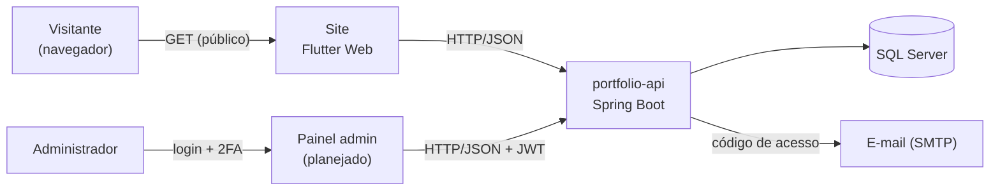
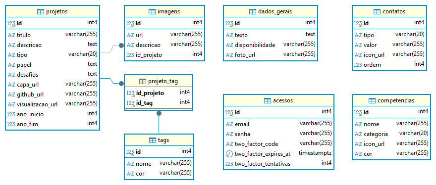

# Portfólio — Gabriel de Jesus

Site de portfólio pessoal full-stack, com a minha trajetória profissional e acadêmica: estágios de P&D na UFPB, projetos da faculdade e o TCC.

O projeto também é um laboratório: o back-end segue práticas usadas no mercado (API REST em camadas, autenticação em duas etapas, testes de integração contra um banco real, configuração por ambiente) em vez de um site estático.

> **Status:** em desenvolvimento.
> - ✅ **API (back-end):** todo o conteúdo do site e o login do painel estão prontos e testados.
> - 🚧 **Site (front-end Flutter):** em planejamento (layout e protótipo).

## Arquitetura



- O **site público** só **lê** os dados da API: projetos, competências, contatos e textos de apresentação.
- O conteúdo é cadastrado por um **painel administrativo** privado. O login tem duas etapas: senha + código enviado por e-mail, que devolve um token JWT.
- As imagens ficam hospedadas fora da API; o banco guarda só as URLs.

### Modelo de dados



Diagrama gerado pelo DBeaver a partir do banco real. `projeto_tag` liga projetos e tags (N:N); `dados_gerais` tem uma única linha (`id = 1`); `acessos` guarda a conta do painel.

## Estrutura do repositório

| Pasta | Conteúdo | Documentação |
|---|---|---|
| [`portfolio-api/`](portfolio-api/) | API REST em Java 17 + Spring Boot 4 | [README da API](portfolio-api/README.md): como rodar, testar, endpoints e decisões de projeto |
| [`web/`](web/) | Site em Flutter Web (ainda o projeto inicial) | Em breve |
| [`doc/`](doc/) | Diagramas | [Modelo relacional](doc/modelo-relacional.png) |

## Tecnologias

| Parte | Tecnologias |
|---|---|
| Back-end | Java 17, Spring Boot 4 (Web MVC, Data JPA, Security, Validation), OAuth2 Resource Server (JWT), Spring Mail |
| Banco de dados | SQL Server 2022 (Docker) |
| Qualidade | JUnit 5, MockMvc, Testcontainers (testes de integração contra um SQL Server real) |
| Documentação da API | OpenAPI 3 / Swagger UI |
| Front-end | Flutter Web |
| Ambiente local | Docker Compose (SQL Server + Mailpit para capturar os e-mails) |

## Como rodar

Hoje, a parte executável é a API. O passo a passo completo está no [README da API](portfolio-api/README.md#como-rodar). Em resumo:

```bash
cd portfolio-api
cp .env.example .env      # defina as senhas
docker compose up -d      # SQL Server + Mailpit
./mvnw spring-boot:run    # API em http://localhost:8080 (Swagger em /swagger-ui.html)
```

Pré-requisitos: JDK 17+ e Docker Desktop.

## Roadmap

- [x] API: projetos, tags, competências, contatos e dados gerais (CRUD completo, com validação e testes)
- [x] API: login em duas etapas (senha + código por e-mail → JWT) e CORS
- [ ] Layout do site no Figma
- [ ] Site em Flutter Web: página única com as seções Sobre, Competências, Projetos e Contato
- [ ] Painel administrativo para cadastrar o conteúdo
- [x] API pronta para produção: migrações com Flyway, perfil de produção e imagem Docker
- [ ] Cache com Redis nas consultas públicas
- [ ] Deploy: API no Google Cloud Run, site no GitHub Pages ou Cloudflare Pages

## Autor

**Gabriel de Jesus**, [GitHub](https://github.com/Gabriel-J-code).
